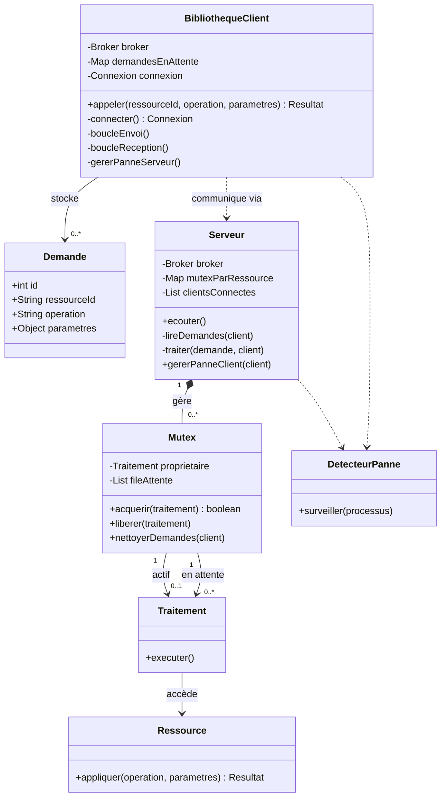

# Design Architectural du Service Stateless

Ce document détaille l'architecture d'un service de gestion de verrous distribués fonctionnant sans état persistant (stateless). Il décrit l'organisation des composants, le cycle de vie des requêtes et les mécanismes de tolérance aux pannes.

## 1. Organisation des Composants

Le système s'articule autour de deux environnements distincts : la bibliothèque cliente (intégrée à l'application) et le serveur central. Les communications s'effectuent via un réseau abstrait par un composant `Broker`.

### Diagramme d'Architecture

## 2. Logique de la Bibliothèque Cliente

La bibliothèque cliente a pour rôle de masquer la communication réseau et de garantir qu'aucune requête n'est perdue. Elle maintient une connexion unique vers le serveur.

### Soumission d'une requête par l'application
Lorsqu'une application souhaite accéder à une ressource :
1. La bibliothèque crée une `Demande` avec un identifiant unique.
2. Elle place cette demande dans un registre local (mémoire vive du client).
3. Elle met le processus de l'application en pause et signale qu'une nouvelle demande est prête à être envoyée.

### Traitement en arrière-plan (Envoi et Réception)
La bibliothèque gère deux processus continus :
* **Processus d'envoi :** Il parcourt le registre local. S'il trouve une demande non envoyée, il la transmet au serveur via la connexion active.
* **Processus de réception :** Il écoute les réponses du serveur. À la réception d'une réponse, il identifie la demande correspondante via son identifiant, enregistre le résultat, retire la demande du registre local, et réveille l'application qui était en pause.

## 3. Logique du Serveur et Gestion des Accès

Le serveur est responsable de la protection des ressources concurrentes. Il ne conserve aucune donnée sur un stockage persistant.

### Réception et Routage
Le serveur écoute les nouvelles connexions. Pour chaque client connecté, un processus dédié lit les demandes entrantes. Lorsqu'une demande est valide, le serveur prépare un `Traitement` et identifie la ressource ciblée.

### Le mécanisme de Mutex (Verrou)
Chaque ressource est protégée par un `Mutex`. Ce composant garantit qu'une seule opération s'exécute à la fois sur une ressource donnée.
1. **Acquisition :** Le traitement demande l'accès au Mutex. Si la ressource est libre, il devient le "propriétaire" et l'opération démarre.
2. **Mise en file d'attente :** Si la ressource est occupée, le traitement est placé dans une file d'attente stricte.
3. **Exécution et Libération :** Une fois l'opération terminée (succès ou échec) et la réponse envoyée au client, le traitement libère le Mutex. Le système notifie alors le traitement suivant dans la file d'attente qu'il peut acquérir la ressource.

## 4. Détection et Tolérance aux Pannes

Le système intègre un détecteur de pannes aux deux extrémités pour réagir aux coupures de connexion.

### Panne d'un Client
Le serveur surveille l'état de ses clients connectés.
* Si un client est déclaré mort, le serveur marque sa connexion comme invalide.
* Il parcourt ensuite tous les Mutex du système et retire de leurs files d'attente tous les traitements initiés par ce client.
* **Sécurité :** Si le client mort possédait déjà un Mutex (opération en cours de calcul), le système n'interrompt pas brutalement l'opération. Il laisse le calcul se terminer, libérer le verrou proprement, puis annule l'envoi de la réponse.

### Panne du Serveur (et Stratégie de Reprise)
C'est le client qui est responsable de la reconnexion.
* **Détection :** Si la lecture ou l'écriture échoue, la bibliothèque cliente marque la connexion comme rompue et suspend les envois.
* **Conservation :** Le registre local des demandes est préservé. L'application appelante reste simplement en pause, sans générer d'erreur fatale.
* **Reconnexion et Renvoi :** La bibliothèque tente de se reconnecter périodiquement. Dès que le serveur est à nouveau disponible, la bibliothèque réémet automatiquement toutes les demandes présentes dans son registre local.
* **Conséquence du modèle Stateless :** Le serveur ayant redémarré avec une mémoire vierge, il traitera les requêtes réémises comme de nouvelles requêtes. Il est donc possible qu'une requête ayant été traitée juste avant la panne soit exécutée une seconde fois. Les opérations métier appelées par ce biais doivent être conçues en conséquence (idempotence).